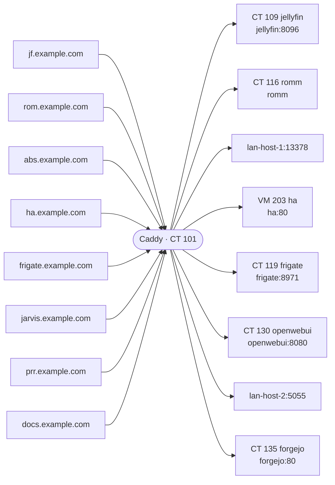

# Network and routes

Caddy (CT 101) sites, from the copy of its Caddyfile taken Nov 23, 2026 5:10 AM.

| Name | Goes to | Machine | Notes |
|---|---|---|---|
| jf.example.com | jellyfin:8096 | [CT 109 jellyfin](guests/ct-109.md) |  |
| rom.example.com | romm | [CT 116 romm](guests/ct-116.md) |  |
| abs.example.com | lan-host-1:13378 |  |  |
| ha.example.com | ha:80 | [VM 203 ha](guests/vm-203.md) | home only, DNS challenge |
| frigate.example.com | frigate:8971 | [CT 119 frigate](guests/ct-119.md) | home only, DNS challenge |
| jarvis.example.com | openwebui:8080 | [CT 130 openwebui](guests/ct-130.md) | home only, DNS challenge |
| prr.example.com | lan-host-2:5055 |  |  |
| docs.example.com | forgejo:80 | [CT 135 forgejo](guests/ct-135.md) | home only, DNS challenge |

## DNS overrides (Unbound on OPNsense)

| Name | Type | Answer | Machine | Notes |
|---|---|---|---|---|
| example.com | A | caddyf2b | [CT 101 CaddyF2B](guests/ct-101.md) |  |

## Uptime Kuma monitors

| Monitor | Address | Status | Machine |
|---|---|---|---|
| bazarr | http://arr:6767 | up | [VM 200 arr](guests/vm-200.md) |
| ErsatzTV | http://ersatztv:8409 | up | [CT 124 ersatztv](guests/ct-124.md) |
| Frigate | http://frigate:5000 | up | [CT 119 frigate](guests/ct-119.md) |
| Grafana | http://lan-host-3:3000 | up |  |
| Home Assistant | http://ha | up | [VM 203 ha](guests/vm-203.md) |
| Jarvis bot Discord | http://debian:8099/health | up | [CT 136 debian](guests/ct-136.md) |
| jarvis-mcp | http://jarvis:8000/health | up | [CT 131 jarvis](guests/ct-131.md) |
| Jellyfin | http://jellyfin:8096 | up | [CT 109 jellyfin](guests/ct-109.md) |
| Jellyseerr | http://lan-host-4:5055 | up |  |
| Komga | http://lan-host-5:25600 | up |  |
| llama-ai | http://lan-host-6:8080/health | down |  |
| Loki | http://lan-host-3:3100/ready | up |  |
| n8n | http://n8n:5678/healthz | up | [CT 128 n8n](guests/ct-128.md) |
| Navidrome | http://lan-host-7:4533 | up |  |
| ntfy | http://lan-host-8/v1/health | up |  |
| ntfy | http://lan-host-8 | up |  |
| openwebui | http://openwebui:8080/health | up | [CT 130 openwebui](guests/ct-130.md) |
| openwebui-https | https://jarvis.example.com | up |  |
| plex | http://plex:32400/identity | up | [CT 108 plex](guests/ct-108.md) |
| Plexseerr | http://lan-host-2:5055 | up |  |
| prowlarr | http://arr:9696 | up | [VM 200 arr](guests/vm-200.md) |
| qbittorrent | http://arr:8080 | up | [VM 200 arr](guests/vm-200.md) |
| radarr | http://arr:7878 | up | [VM 200 arr](guests/vm-200.md) |
| romm | http://romm | up | [CT 116 romm](guests/ct-116.md) |
| sabnzbd | http://arr:8085 | up | [VM 200 arr](guests/vm-200.md) |
| SearXNG | http://searxng:8888/healthz | up | [CT 132 searxng](guests/ct-132.md) |
| sonarr | http://arr:8989 | up | [VM 200 arr](guests/vm-200.md) |
| Tautulli | http://lan-host-9:8181 | up |  |
| UniFi OS | https://unifi-os-server:11443 | up | [CT 120 unifi-os-server](guests/ct-120.md) |
